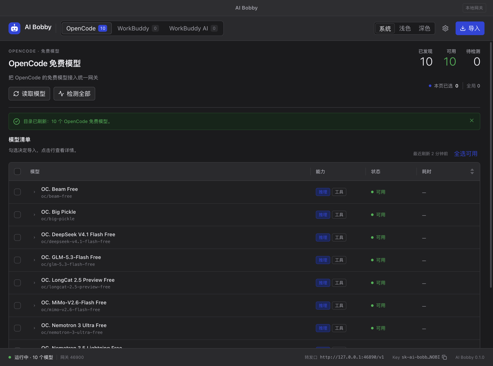
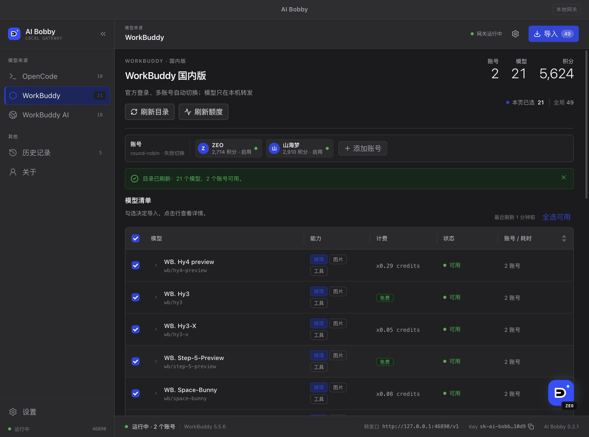
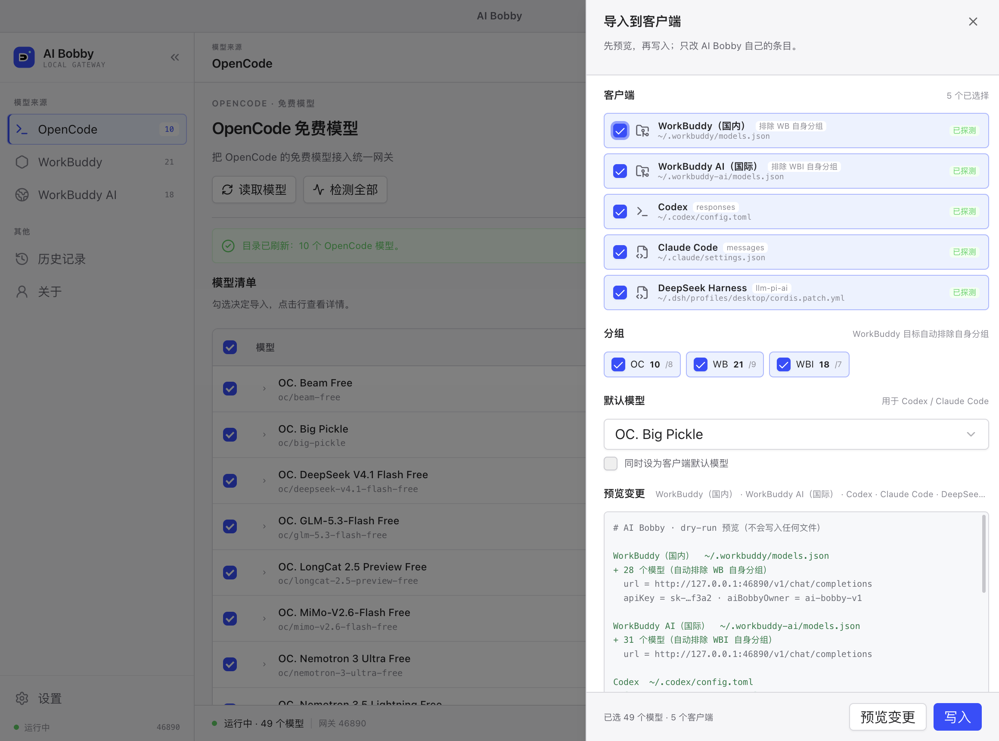
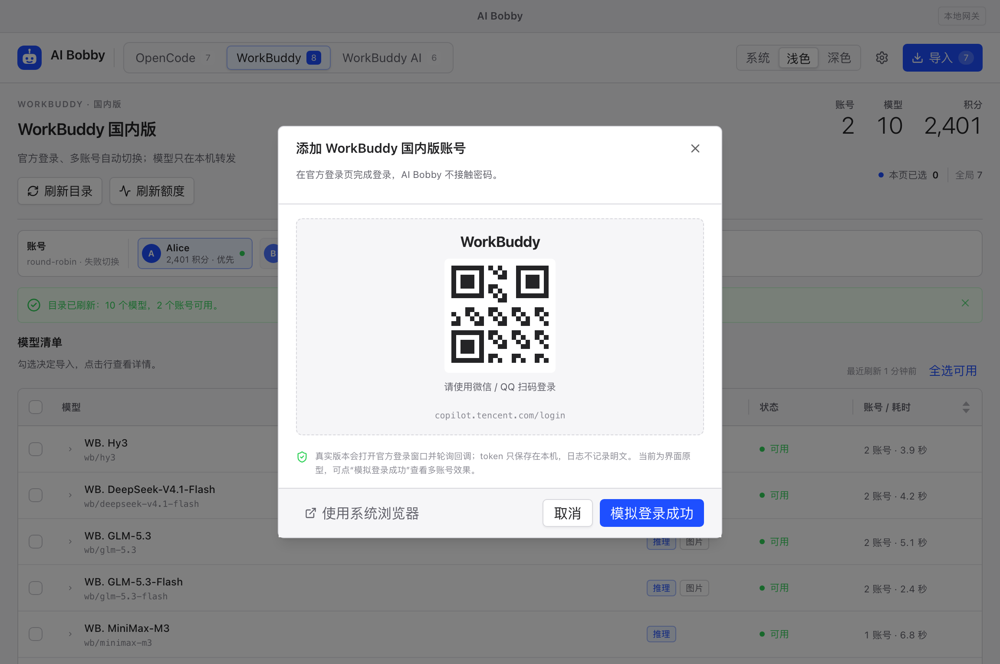
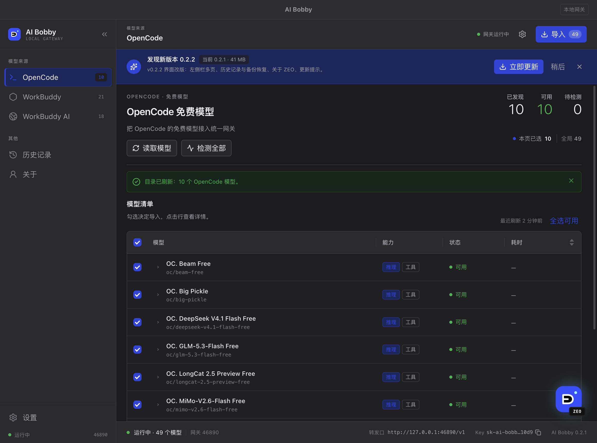
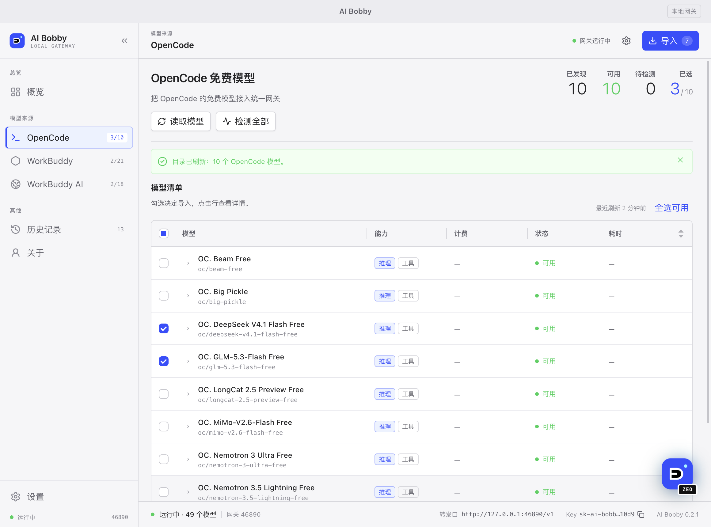

# AI Bobby

本地 AI 服务网关：把 **OpenCode 免费模型**、**WorkBuddy（国内版）**、**WorkBuddy AI（国际版）**
收敛成一个 `127.0.0.1:46890` 端点、一把 API Key、一个桌面控制面板，
并支持一键导入 WorkBuddy / Codex / Claude Code / DeepSeek Harness。

> **状态（2026-10-18）**：源码已包含 46890 网关（Chat / Responses / Messages）、
> WorkBuddy 官方登录 + 多账号 provider、四个客户端 importer、桌面真实状态与更新/分发链路。
> OpenCode 免费模型、真实 Codex 0.154 与 Claude Code 2.1 已在本机跑通；
> **WorkBuddy 真实账号联调**仍需要你登录一次；OpenCode、Codex、Claude Code 与四个
> importer 已在本机验证。`v0.2.1` 已发布，安装/更新通道指向它。详见 [handsoff.md](./handsoff.md)。



## 安装（macOS，ad-hoc 签名公测）

```bash
curl -fsSL https://xsin.github.io/ai-bobby/releases/latest/install.sh | bash
```

可审计安装：

```bash
curl -fsSL https://xsin.github.io/ai-bobby/releases/latest/install.sh -o install.sh
less install.sh && bash install.sh
```

默认安装到 `~/Applications/AI Bobby.app`；`--system` 可装到 `/Applications`。
二进制托管在 **GitHub Release**（gh-pages 只放安装脚本、版本号与更新清单，因为 GitHub 对 Git 文件有 100MB 限制）。
当前 release：<https://github.com/xsin/ai-bobby/releases/tag/v0.2.1>（网关 + OpenCode + Codex/Claude 联调）。
首版未做 Apple 公证，首次打开若被 Gatekeeper 阻止：

```bash
xattr -dr com.apple.quarantine "$HOME/Applications/AI Bobby.app"
```

## 它会做什么

| 来源 | 分组 | 登录 |
|---|---|---|
| OpenCode 免费模型池 | `OpenCode` | 无需登录，按价格字段筛免费模型 |
| WorkBuddy 国内版 | `WorkBuddy` | 官方登录页 + state/poll，多账号 |
| WorkBuddy AI 国际版 | `WorkBuddy AI` | 官方登录页 + state/poll，多账号 |

- 模型 ID：`oc/<id>`、`wb/<id>`、`wbi/<id>`；显示名：`OC.` / `WB.` / `WBI.`。
- 同时提供 **OpenAI Chat Completions**、**OpenAI Responses**（Codex）、
  **Anthropic Messages**（Claude Code）三种协议面。
- 多账号 `round-robin + 失败切换`；401 刷新、429/402 冷却换号。
- 一键导入：WorkBuddy `models.json`、Codex `config.toml`、Claude Code `settings.json`、
  DSH `cordis.patch.yml`；写前 dry-run + 备份 + 归属标记 + 可回滚。
- 自动更新：启动后静默检查、非模态更新条、下载/校验/替换/重启。

## 界面

| | |
|---|---|
|  |  |
| WorkBuddy 多账号与额度 | 全局导入：dry-run 预览 |
|  |  |
| 官方登录页（多账号） | 非模态更新条 |

浅色主题：

## 当前源码已实现

- `packages/core`：模型注册表、Canonical 请求/事件、错误与日志脱敏
- `packages/gateway`：`/v1/chat/completions`、`/v1/responses`、`/v1/messages`、
  `/v1/messages/count_tokens`、`/v1/models`、`/health`；API Key、Origin/Host 围栏
- `packages/workbuddy`：官方登录 state/poll、AccountStore、目录/兜底、chat SSE、刷新、billing、多账号调度
- `packages/opencode`：npm 运行时下载/SHA-512 校验、隔离 serve、免费模型过滤、CLI `run` 转发与工具信封
- `packages/importers`：WorkBuddy / Codex / Claude Code / DSH 的 dry-run / 备份 / 原子写 / 回滚
- `apps/desktop`：主进程启动 46890 网关，renderer 读真实模型/账号，内嵌登录窗口与导入 IPC
- `apps/cli`：`pnpm --filter @ai-bobby/cli start` 可无界面起网关

```bash
AI_BOBBY_DATA_DIR=~/.ai-bobby pnpm --filter @ai-bobby/cli start
curl -s http://127.0.0.1:46890/health
```

## 技术栈

- **React 19.3.1** + **TypeScript 7.0.2** + **Vite 8.3.4** + **Electron 44.9.0**
- **Tailwind CSS 4.3.3** + **shadcn/ui 4.22**（视觉层）
- **Ant Design 6.6.6**（模型表格等功能层，按 [ui-guideline.md](./ui-guideline.md) 做 token 桥接）
- pnpm 10 workspace；`electron-vite` 构建 main/preload/renderer
- 主题色：**电光克莱因蓝 `#1e4fff`**
- 所有依赖精确 pin；升级走 `pnpm up --latest` 并记录

## 文档

- [handsoff.md](./handsoff.md) — 实施计划、决策、进度、跨会话记忆
- [prd.md](./prd.md) — 产品范围、FR、界面、验收
- [tech.md](./tech.md) — 架构、协议、登录/多账号、更新/分发、测试
- [human-sos.md](./human-sos.md) — **需要人工处理/确认的事项**
- [prototype/](./prototype/) — 早期静态可点击原型（已被 React UI 取代）
- [ui-guideline.md](./ui-guideline.md) — shadcn/Tailwind/antd 分层规范

## 开发

```sh
pnpm install
pnpm --filter @ai-bobby/desktop dev      # Electron + Vite 开发
pnpm --filter @ai-bobby/desktop build    # 构建 out/
pnpm --filter @ai-bobby/desktop typecheck
pnpm --filter @ai-bobby/desktop test
```

只预览 renderer（无需 Electron）：

```sh
cd apps/desktop && pnpm build
python3 -m http.server 8766 --bind 127.0.0.1 -d out/renderer
# http://127.0.0.1:8766/
```

发布（本地）：

```sh
bash scripts/release/build-mac.sh --arch arm64 --out-dir release-site/releases/0.2.1
bash scripts/release/build-mac.sh --arch x64   --out-dir release-site/releases/0.2.1
node scripts/release/validate.mjs release-site/releases/0.2.1
```

CI：推送 `v*` tag 触发 [.github/workflows/release.yml](./.github/workflows/release.yml)，
构建 arm64/x64 → ad-hoc 签名 → zip/checksums/latest.json → gh-pages + GitHub Release。

## 目录

```
apps/desktop          Electron 主进程 + shadcn/Tailwind/antd 控制面板
packages/core         领域模型、注册表、设置、日志
packages/workbuddy    WorkBuddy 双版本登录/账号/目录/聊天/调度
packages/opencode     OpenCode 运行时/免费筛选/检测
packages/gateway      46890 网关与三种协议 codec
packages/importers    四个客户端的一键导入
scripts/release       版本、构建、签名、manifest、安装脚本
refs/                 只读参考实现（.gitignore，不发布）
```

## 免责声明

WorkBuddy 的登录与模型接口不是公开 API；本项目仅用于个人学习与研究，
请遵守上游服务条款，风险自担。本项目与腾讯、WorkBuddy、DeepSeek 无关联。

## License

MIT（见 [LICENSE](./LICENSE)）。参考实现的许可见 [THIRD_PARTY_NOTICES.md](./THIRD_PARTY_NOTICES.md)。
