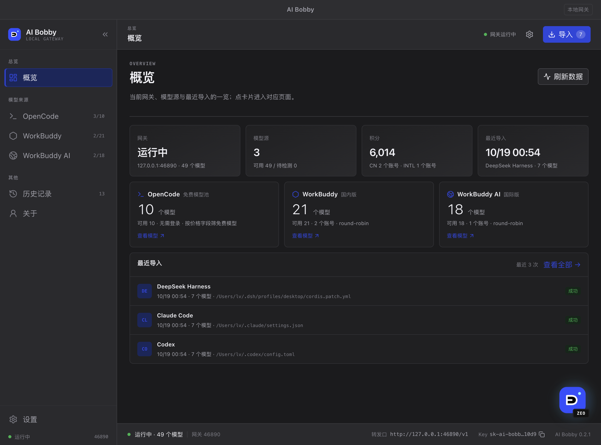
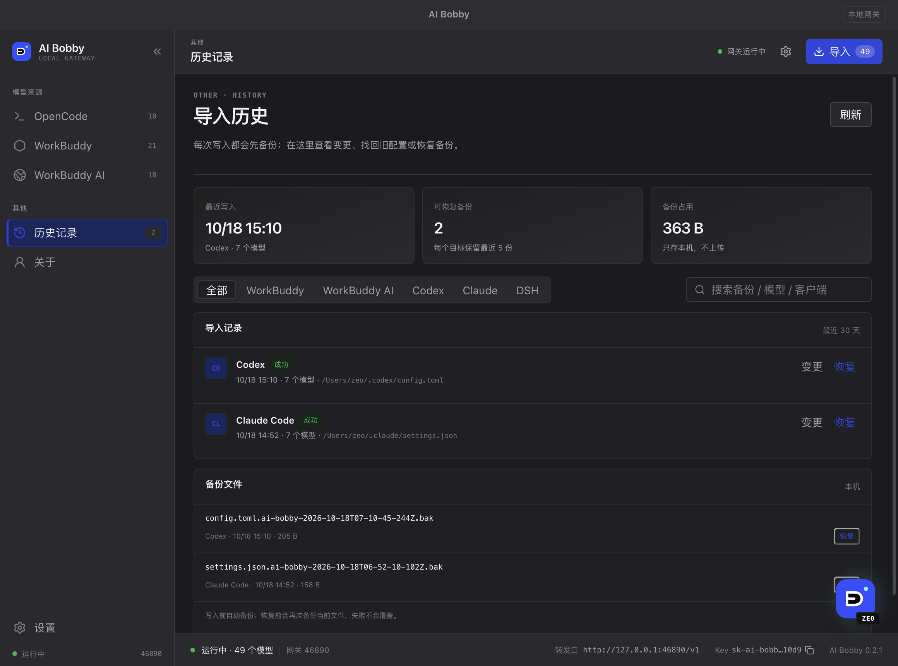
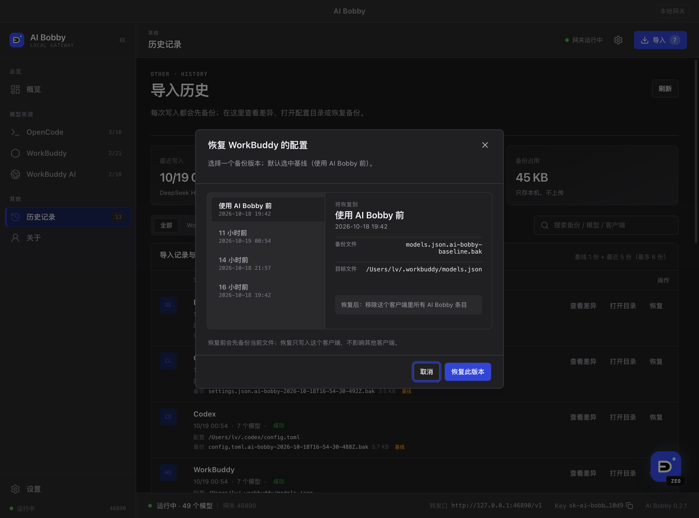
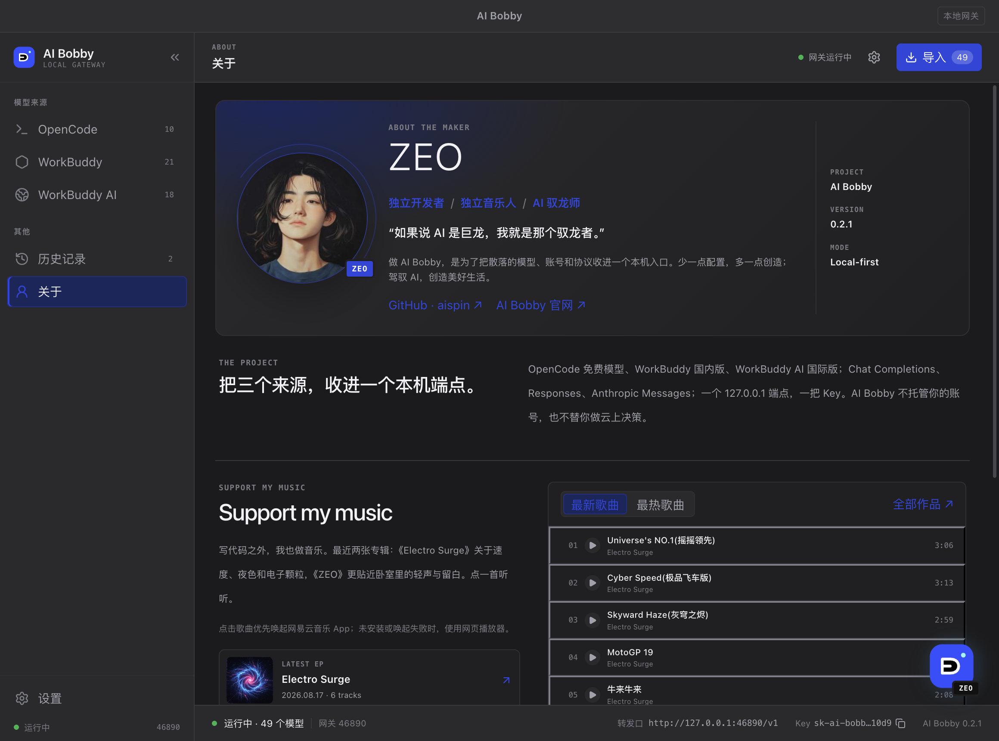

# AI Bobby

**所有模型，一個本機端點。**

AI Bobby 是一個本機優先的桌面 AI 閘道：把 **OpenCode 免費模型池**、**WorkBuddy（國內版）**
和 **WorkBuddy AI（國際版）** 收斂到 `127.0.0.1:46890` 一個 OpenAI 相容端點 ——
一個 API Key、三種協定，配一個原生 macOS 控制面板。

[English](./README.md) · [简体中文](./README.zh-CN.md) · **繁體中文**

*介面目前僅提供簡體中文；本文的按鈕名稱按繁體轉寫。*

> **狀態（2026-10-19）：** `v0.2.2` 已發布。修復 WorkBuddy / WorkBuddy AI 的 `deepseek`
> 上游 abort；匯入備份改為 1 份基線 + 最近 5 份，並支援按版本還原；統一按鈕與 hover；
> 行動端落地頁增加兜底。閘道（Chat / Responses / Messages）、OpenCode 免費模型、
> WorkBuddy 雙版本 provider、四個 importer、自動更新與 curl 安裝鏈路均已上線。
> **WorkBuddy 仍需要你本人掃碼登入。**
> 落地頁：<https://xsin.github.io/ai-bobby/>


## 你會得到什麼

- **一個端點** —— `http://127.0.0.1:46890/v1` 同時支援 OpenAI Chat Completions、
  OpenAI Responses 和 Anthropic Messages。
- **三個模型來源** —— OpenCode 免費池、WorkBuddy（國內版）、WorkBuddy AI（國際版），
  合併成一份模型清單，並標註免費或計費倍率。
- **多帳號** —— 每個來源可新增多個 WorkBuddy 帳號，預設 round-robin + 失敗切換。
- **一鍵匯入** —— 把 AI Bobby 端點寫入 WorkBuddy、Codex、Claude Code 和 DeepSeek Harness，
  寫入前有即時 diff 預覽。
- **歷史與還原** —— 每次寫入前自動備份；可在歷史頁還原基線或最近 5 份快照。
- **只在本機** —— 只監聽 `127.0.0.1:46890`，拒絕瀏覽器 `Origin` 請求，不做遙測。

## 安裝（macOS，ad-hoc 簽名公測）

推薦一行安裝：

```bash
curl -fsSL https://xsin.github.io/ai-bobby/releases/latest/install.sh | bash
```

可審計安裝：

```bash
curl -fsSL https://xsin.github.io/ai-bobby/releases/latest/install.sh -o install.sh
less install.sh && bash install.sh
```

- 預設安裝到 `~/Applications/AI Bobby.app`；`--system` 可裝到 `/Applications`。
- 當前 release：<https://github.com/xsin/ai-bobby/releases/tag/v0.2.2>
- 二進位託管在 **GitHub Releases**；gh-pages 只放安裝指令碼、版本號、校驗和與更新清單。
- 當前版本未做 Apple 公證。首次開啟若被 Gatekeeper 阻止：

```bash
xattr -dr com.apple.quarantine "$HOME/Applications/AI Bobby.app"
```

## 為什麼 macOS 會提示聯網

AI Bobby 目前是 **ad-hoc 簽名、未公證** 的公測版，Electron Helper 沒有 Developer ID。
Little Snitch 會把“未簽名程序要聯網”標成風險，這是簽名狀態導致的提示，不是應用在掃描區域網路。

它需要聯網的原因只有三類：

- 存取 WorkBuddy / WorkBuddy AI 上游介面（登入、模型目錄、聊天、額度）；
- 首次下載 OpenCode 執行環境；
- 檢查 GitHub Release 更新。

本機閘道只監聽 `127.0.0.1:46890`，不會把連接埠暴露到區域網路或公網，也不做遙測。

建議：

- 在 Little Snitch 提示中給 **AI Bobby / Electron Helper** 建**單獨規則**，不要建 “any via-process” 的寬泛規則。
- 只測本機閘道時可先選 **Only local network**；要登入 WorkBuddy 或首次下載 OpenCode 時，需要允許對應出站連線。
- 不要直接 Deny 整個程序，否則 WorkBuddy / OpenCode / 更新會失敗。
- 如果不想放行，退出 AI Bobby 即可；它不會修改系統代理，也不會後台常駐網路行為。

> 開發環境下看到的 `DeepSeek Harness via Electron Helper` 提示來自 DSH 開發工具本身，不是 AI Bobby 的閘道。

## 第一次使用

1. 啓動 AI Bobby。應用只監聽本機 `127.0.0.1:46890`。
2. 在左側欄 **OpenCode** 頁點“讀取模型”。首次執行會下載 OpenCode 執行環境，需要網路，可能要等一會兒。
3. 切到 **WorkBuddy** 或 **WorkBuddy AI** 頁，點“新增帳號”。會開啟 WorkBuddy 官方登入窗口；
   完成掃碼/授權後窗口自動關閉，帳號進入本機帳號庫。同一來源可新增多個帳號，
   預設 round-robin + 失敗切換。
4. 勾選要暴露給用戶端的模型。模型清單的 **計費** 列標出免費（`免費`）或消耗倍率（如 `x0.79`）。
   開啟應用時預設不勾選；應用會讀取各用戶端設定，把已經匯入的模型自動勾上。點右上角 **匯入**，
   選擇用戶端、分組和預設模型，變更預覽會隨選擇即時更新，確認後寫入。寫入前會備份，
   只改 AI Bobby 自己標記的條目。
5. 在底部狀態列複製 **轉發口** 與 **API Key**，填到 Codex / Claude Code / DSH / WorkBuddy。
6. **歷史記錄**頁查看每次寫入、diff 與備份，可一鍵還原；還原前會再備份當前檔案。
7. **設定**頁切換主題、手動檢查更新、複製閘道地址/Key；**關於**頁有 ZEO、音樂與贊助方式。
8. 點擊關於頁歌曲會優先喚起本機網易雲音樂 App；未安裝或喚起失敗時，自動使用全局可拖動網頁播放器。
   用戶端沒開著時會先把它啓動起來再補發一次播放指令，不用點第二次。
   專輯卡片開啟網易雲專輯網頁；當前用戶端不支援專輯深鏈，會提示並開啟網頁版。
9. 右下角應用 LOGO 頭像可拖動，點擊進入關於。

## 模型來源

| 來源 | 分組 | 登入 |
|---|---|---|
| OpenCode 免費模型池 | `OpenCode` | 無需登入，按價格欄位篩免費模型 |
| WorkBuddy 國內版 | `WorkBuddy` | 官方登入頁 + state/poll，多帳號 |
| WorkBuddy AI 國際版 | `WorkBuddy AI` | 官方登入頁 + state/poll，多帳號 |

## 接入用戶端

統一端點：

```text
http://127.0.0.1:46890/v1
```

驗證：

- OpenAI 相容路徑：`Authorization: Bearer <API Key>`
- Anthropic Messages：`Authorization: Bearer <API Key>` 或 `x-api-key: <API Key>`
- 瀏覽器帶 `Origin` 的請求會被 403 拒絕；這是給本機用戶端用的連接埠。

模型 ID：

- `oc/<upstream-id>`，顯示名 `OC. <name>`
- `wb/<upstream-id>`，顯示名 `WB. <name>`
- `wbi/<upstream-id>`，顯示名 `WBI. <name>`

### OpenAI Chat Completions

```bash
curl http://127.0.0.1:46890/v1/chat/completions \
  -H "Authorization: Bearer $AI_BOBBY_KEY" \
  -H "Content-Type: application/json" \
  -d '{
    "model": "oc/space-bunny-free",
    "messages": [{"role": "user", "content": "你好"}]
  }'
```

### OpenAI Responses（Codex）

```bash
curl http://127.0.0.1:46890/v1/responses \
  -H "Authorization: Bearer $AI_BOBBY_KEY" \
  -H "Content-Type: application/json" \
  -d '{"model":"oc/space-bunny-free","input":"你好"}'
```

### Anthropic Messages（Claude Code）

```bash
curl http://127.0.0.1:46890/v1/messages \
  -H "Authorization: Bearer $AI_BOBBY_KEY" \
  -H "Content-Type: application/json" \
  -d '{
    "model": "oc/space-bunny-free",
    "max_tokens": 256,
    "messages": [{"role": "user", "content": "你好"}]
  }'
```

其他端點：

| 方法 | 路徑 | 用途 |
|---|---|---|
| GET | `/health` | 健康檢查（無需 Key） |
| GET | `/v1/models` | 當前暴露的模型清單 |
| POST | `/v1/chat/completions` | OpenAI Chat，串流/非串流 |
| POST | `/v1/responses` | OpenAI Responses，串流/非串流 |
| POST | `/v1/messages` | Anthropic Messages，串流/非串流 |
| POST | `/v1/messages/count_tokens` | 近似 token 計數 |

模型清單預設只回傳 `available` / `chat_only`；`GET /v1/models?all=1` 可以看到待檢測/不可用模型。

## 匯入目標

| 用戶端 | 寫入位置 | 協定 | 說明 |
|---|---|---|---|
| WorkBuddy 國內版 | `~/.workbuddy/models.json` | Chat | 預設排除 `wb/` 自身分組，避免自環 |
| WorkBuddy AI | `~/.workbuddy-ai/models.json` | Chat | 預設排除 `wbi/` 自身分組 |
| Codex | `~/.codex/config.toml` | Responses | 寫入 `[model_providers.ai-bobby]` 標記塊，可選預設模型 |
| Claude Code | `~/.claude/settings.json` | Messages | 合併 `env.ANTHROPIC_BASE_URL / AUTH_TOKEN / MODEL` |
| DeepSeek Harness | `~/.dsh/profiles/<profile>/cordis.patch.yml` | Chat | 合併 `llm-pi-ai` 的 `ai-bobby` provider；同時把閘道 Key 寫入 DSH 憑據存儲（`refs.AI_BOBBY_API_KEY`），不需要設環境變量 |

共同行為：

- 先 dry-run 展示 diff；確認後才寫。
- 寫入前備份、檔案鎖、原子替換；只改 AI Bobby 標記的條目。
- 重複匯入冪等；使用者手寫條目不會被覆蓋。
- 匯入器 API 支援回滾（`rollback`）；**當前桌面 UI 還沒暴露回滾按鈕**。
- Codex / Claude 的預設模型會在勾選“設為預設”時寫入。

## 歷史與備份

- 每次實際寫入用戶端前，importer 會先備份目標檔案；每個目標保留 **1 份基線**（首次寫入前）+ **最近 5 份**滾動備份。
- **歷史記錄**頁把匯入記錄與備份合併成一張表：用戶端、時間 · 模型數 · 狀態、設定路徑、備份檔。
  可按用戶端篩選、按路徑搜尋；支援「查看差異」（只讀 diff）、「開啟目錄」（Finder 定位）和「還原」。
- 點“還原”可在彈窗里選擇版本：基線（使用 AI Bobby 前）或最近 5 份滾動備份，預設選中基線；
  還原前會先備份當前檔案，失敗不會覆蓋。
- 記錄與備份只在本機：`import-history.json` 為 `0600`，diff 中的 Key/token 會先脫敏。
- 重複匯入且內容未變時回傳 `changed:false`，不會新增歷史或備份。

## CLI（無介面起閘道）

```bash
AI_BOBBY_DATA_DIR=~/.ai-bobby pnpm --filter @ai-bobby/cli start
# 指定連接埠
AI_BOBBY_DATA_DIR=~/.ai-bobby AI_BOBBY_PORT=46890 pnpm --filter @ai-bobby/cli start
# 只查看帳號/模型狀態
AI_BOBBY_DATA_DIR=~/.ai-bobby pnpm --filter @ai-bobby/cli status
```

首次執行會在資料目錄產生 `api-key`（`0600`）。API Key 也可以從桌面狀態列複製。

## 介面

| | |
|---|---|
|  |  |
| 概覽：閘道、模型源、積分與最近匯入 | 左側欄多頁導航 + 模型清單 |
|  |  |
| 匯入記錄與備份合併表格 | 全局匯入：即時預覽 + 預設模型 |
|  |  |
| 還原：基線 + 最近 5 份版本切換 | 非模態更新條 |
|  |  |
| 關於 ZEO、音樂與贊助 | WorkBuddy 多帳號、額度與計費 |

更多截圖：[淺色主題](docs/screenshots/06-opencode-light.png)、[全局播放器](docs/screenshots/09-music-player-dark.png)、
[設定頁（主題唯一入口）](docs/screenshots/10-settings-dark.png)、
[收起的側邊欄](docs/screenshots/11-collapsed-dark.png)、
[登入彈窗](docs/screenshots/04-login-light.png)。

## 資料目錄與安全

- 資料目錄：macOS `~/Library/Application Support/AI Bobby`；可用 `AI_BOBBY_DATA_DIR` 覆蓋。
- `api-key`、帳號庫、`import-history.json` 等敏感檔案以 `0600` 儲存在本機。
- 帳號庫當前是 `0600` 明文；Electron `safeStorage` 因啓動時可能阻塞 Keychain 暫未預設啓用。
- 日誌與狀態不記錄 access token / refresh token / API Key 明文；匯入歷史 diff 同樣脫敏。
- WorkBuddy 登入在官方頁面完成，AI Bobby 不接觸密碼；但後續接口不是公開 API，請遵守上游條款。

## 故障排查

**首次開啟提示“已損壞”/無法開啟**

```bash
xattr -dr com.apple.quarantine "$HOME/Applications/AI Bobby.app"
```

**46890 連接埠被佔用**

關閉佔用程序，或僅在開發/CLI 場景用 `AI_BOBBY_PORT` 改連接埠。
桌面安裝版預設固定 46890，因為用戶端設定依賴這個地址。

**OpenCode 模型為空**

首次讀取需要下載執行環境，確認網路可存取 npm registry / GitHub。
點“讀取模型”重試；仍失敗時查看資料目錄下日誌，或先在終端執行
`pnpm --filter @ai-bobby/cli start` 觀察錯誤。

**WorkBuddy 登入窗口空白**

先把同一個 `authUrl` 用系統瀏覽器開啟完成登入；桌面端會繼續輪詢 token。
登入成功但模型為空時，檢查帳號是否啓用、是否被上游限流/額度不足。

**匯入後用戶端沒變化**

確認已重新啟動對應用戶端；在匯入預覽裡檢查目標路徑與 diff。
Codex/Claude 的設定塊只改 AI Bobby 標記的部分，不會覆蓋其他 provider。

**關於頁點擊歌曲沒有在 App 中播放**

確認已安裝網易雲音樂 macOS 用戶端，並允許系統透過 `orpheus://` 喚起它。
未安裝或喚起失敗時，AI Bobby 會自動切到網頁播放器；App 內能否播放仍取決於登入、會員、版權與地區限制。

## 已知限制

- WorkBuddy 真實帳號登入/上游聯調仍需人工驗證；目前只驗證到官方登入頁可開啟。
- OpenCode 原生工具目前是 prompt 級約束，未做強制沙箱；請不要讓不可信 prompt 驅動本機工具。
- OpenCode 免費模型的檢測/延遲快取尚未實現，目錄先標 `available`。
- 當前只驗證 macOS；Windows 打包與更新未實現。
- ad-hoc 簽名、未公證；首次開啟可能需要手動清 quarantine。

## 開發

```sh
pnpm install
pnpm --filter @ai-bobby/desktop dev      # Electron + Vite 開發
pnpm --filter @ai-bobby/desktop build    # 建置 out/
pnpm --filter @ai-bobby/desktop typecheck
pnpm --filter @ai-bobby/desktop test
pnpm --filter @ai-bobby/website dev       # 落地頁開發
pnpm --filter @ai-bobby/website build     # 落地頁建置
```

只預覽 renderer（無需 Electron）：

```sh
cd apps/desktop && pnpm build
python3 -m http.server 8766 --bind 127.0.0.1 -d out/renderer
# http://127.0.0.1:8766/
```

發布（本機）：

```sh
bash scripts/release/build-mac.sh --arch arm64 --out-dir release-site/releases/0.2.2
bash scripts/release/build-mac.sh --arch x64   --out-dir release-site/releases/0.2.2
node scripts/release/validate.mjs release-site/releases/0.2.2
```

CI：推送 `v*` tag 觸發 [.github/workflows/release.yml](./.github/workflows/release.yml)，
建置 arm64/x64 → ad-hoc 簽名 → zip/checksums/latest.json → gh-pages + GitHub Release。

## 目錄

```
apps/desktop          Electron 主程序 + shadcn/Tailwind/antd 控制面板
apps/website          React/Vite/Three/PWA 落地頁（中英文）
apps/cli              無介面閘道
packages/core         領域模型、註冊表、設定、日誌
packages/workbuddy    WorkBuddy 雙版本登入/帳號/目錄/聊天/調度
packages/opencode     OpenCode 執行環境/免費篩選/轉發
packages/gateway      46890 閘道與三種協定 codec
packages/importers    四個用戶端的一鍵匯入
scripts/release       版本、建置、簽名、manifest、安裝指令碼
docs/prd.md           產品範圍、FR、介面、驗收
docs/tech.md          架構、協定、登入/多帳號、更新/分發、測試
refs/                 只讀參考實現（.gitignore，不發布）
```

## 說明文件

- [handsoff.md](./handsoff.md) — 實施計劃、決策、進度、跨會話記憶
- [docs/README.md](./docs/README.md) — 說明文件索引與“只寫當前狀態”規範
- [docs/prd.md](./docs/prd.md) — 產品範圍、FR、介面、驗收
- [docs/tech.md](./docs/tech.md) — 架構、協定、登入/多帳號、更新/分發、測試
- [docs/prd-landing.md](./docs/prd-landing.md) — 落地頁 PRD（已實現）
- [docs/tech-landing.md](./docs/tech-landing.md) — 落地頁技術方案（React/Vite/Three/PWA）
- [human-sos.md](./human-sos.md) — **需要人工完成/確認的交付事項**
- [prototype/](./prototype/) — 視覺稿：`desktop/` 控制面板、`website/` 落地頁
- [docs/ui-guideline.md](./docs/ui-guideline.md) — shadcn/Tailwind/antd 分層與 4px 間距規範

## 專案狀態

- **Website（落地頁）**：已實現於 [`apps/website`](./apps/website)，支援中英文與 PWA 更新提醒；
  視覺母版在 [`prototype/website/`](./prototype/website/)。線上：
  <https://xsin.github.io/ai-bobby/>。
- **Marketing / Lucia**：已拆分為同級獨立專案（`ai-lucia`），不在本儲存庫。
- **依賴版本**：所有第三方版本收斂到 `pnpm-workspace.yaml` 的 `catalog:`，子專案只寫 `catalog:`。

## 免責聲明

WorkBuddy 的登入與模型接口不是公開 API；本專案僅用於個人學習與研究，
請遵守上游服務條款，風險自擔。本專案與騰訊、WorkBuddy、DeepSeek 無關聯。

## License

MIT（見 [LICENSE](./LICENSE)）。參考實現的許可見 [THIRD_PARTY_NOTICES.md](./THIRD_PARTY_NOTICES.md)。
